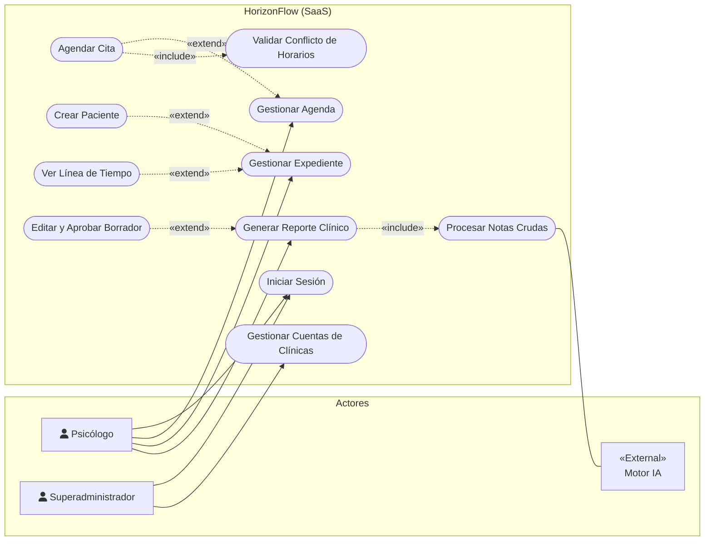
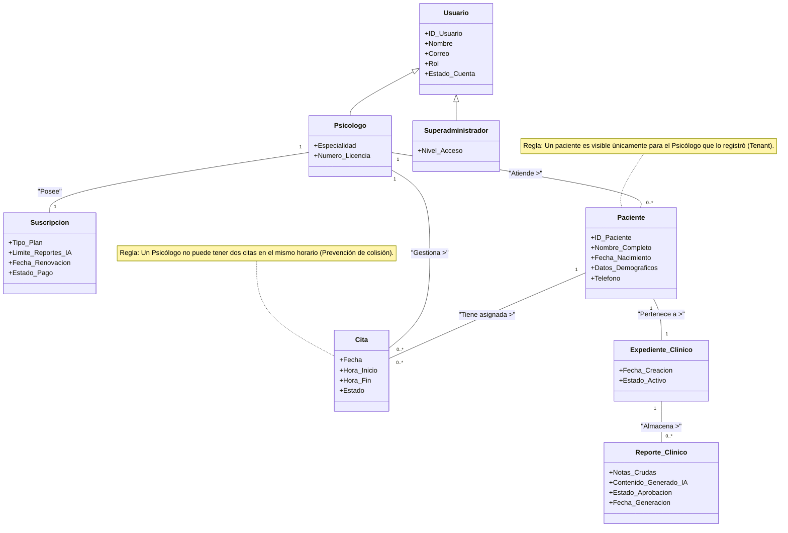
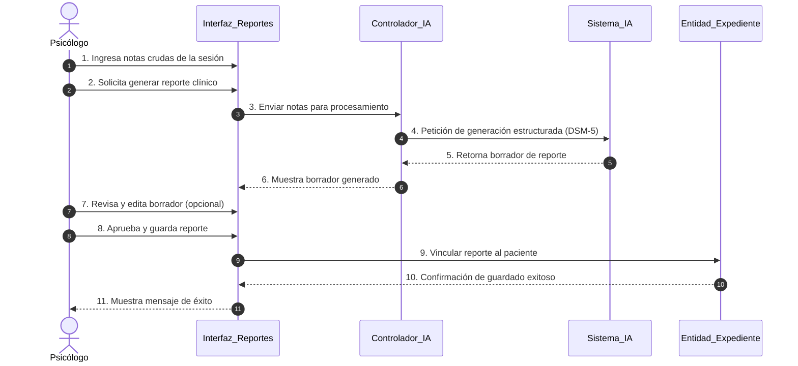
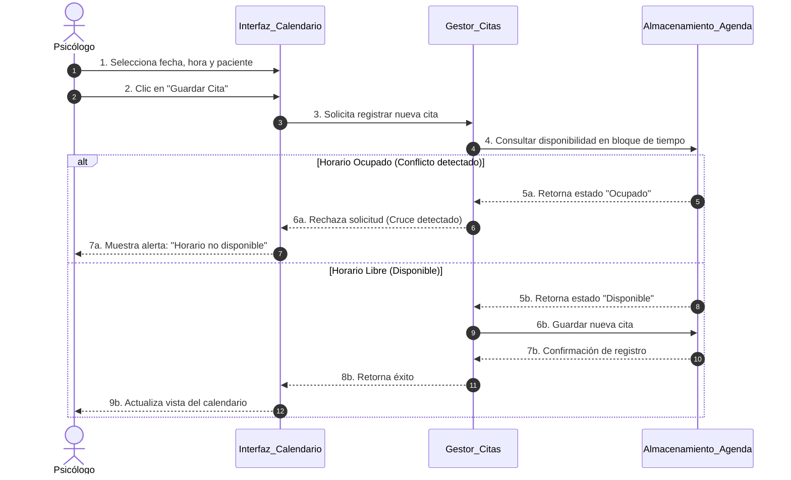
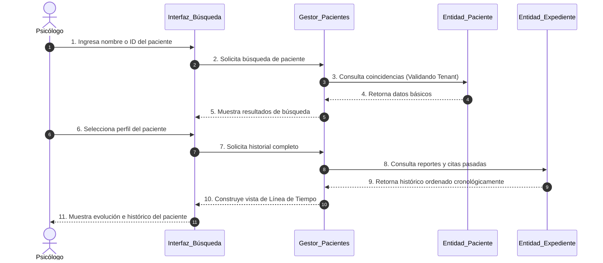
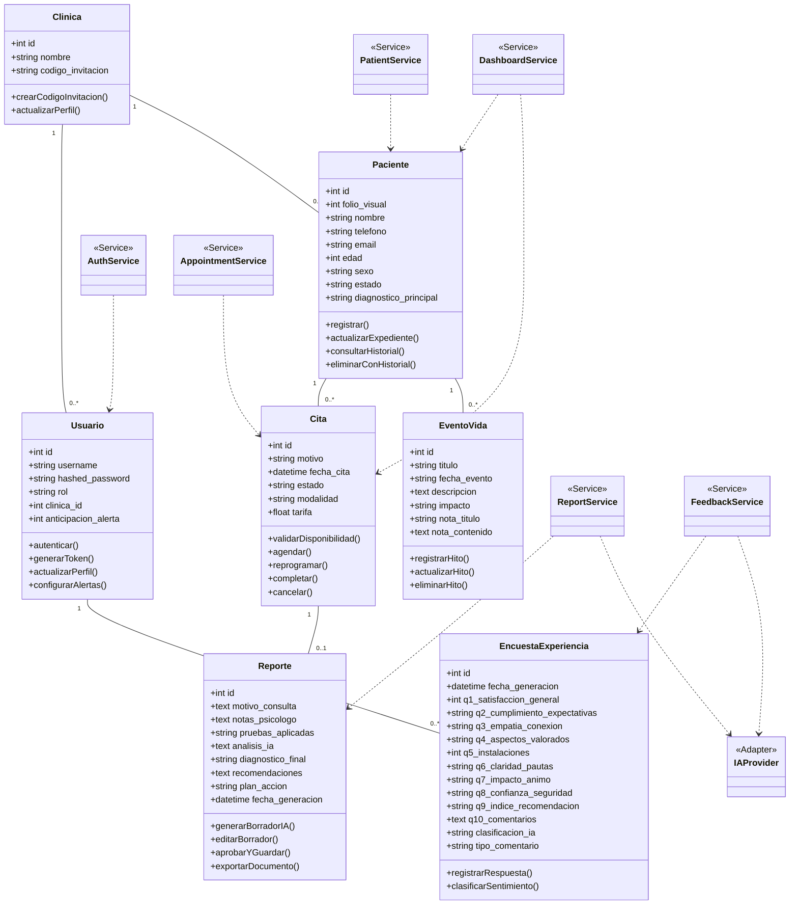
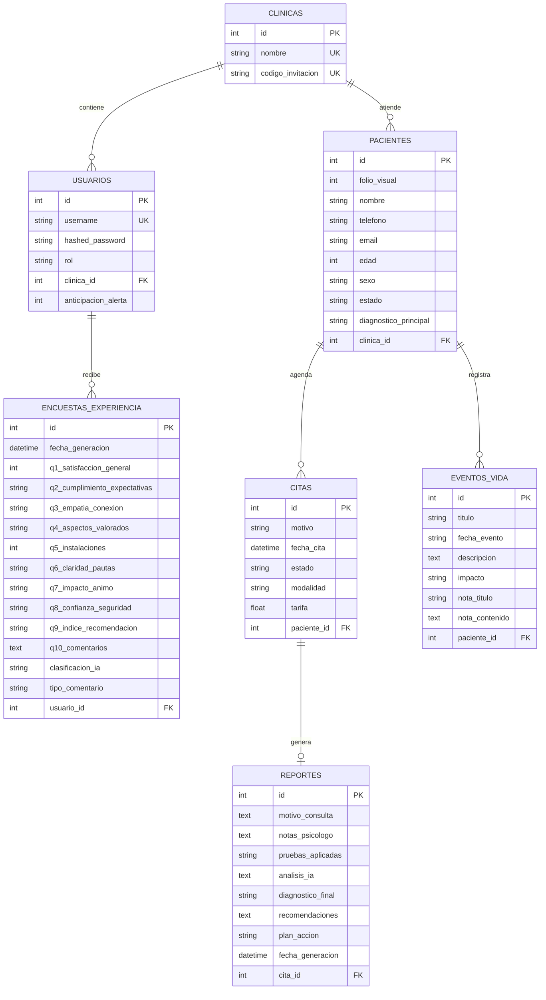
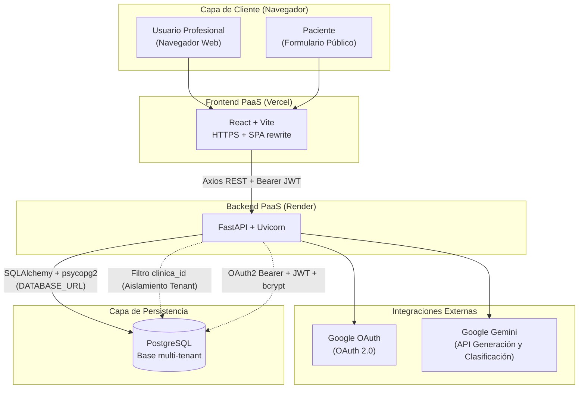
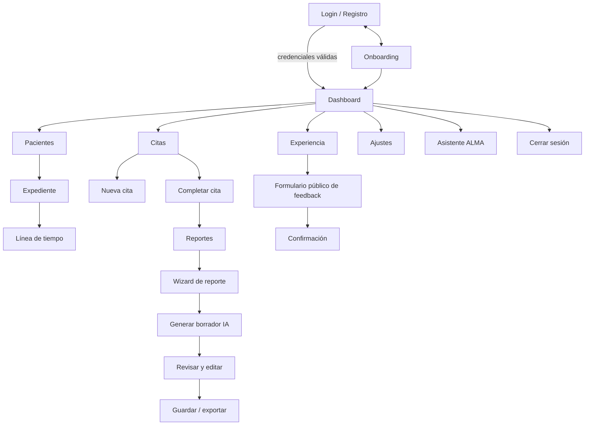

# HorizonFlow — Plataforma SaaS Multi-Tenant para Psicología

HorizonFlow es una solución web integral diseñada para optimizar y centralizar la práctica profesional de psicólogos independientes y clínicas de salud mental. La plataforma digitaliza expedientes clínicos, centraliza la agenda inteligente previniendo cruces de horarios, automatiza la estructuración de reportes clínicos asistidos por Inteligencia Artificial (Gemini API) y recopila retroalimentación de pacientes bajo un esquema estricto de privacidad multi-tenant y cumplimiento de la Ley 787 de protección de datos personales.

---

## Índice

- [1. Puesta en Marcha y Desarrollo](#1-puesta-en-marcha-y-desarrollo)
  - [Requisitos](#requisitos)
  - [Instalación Local](#instalación-local)
  - [Comandos Disponibles](#comandos-disponibles)
  - [Entorno de Producción y URLs](#entorno-de-producción-y-urls)
  - [Smoke Test de Calidad](#smoke-test-de-calidad)
- [2. Diagramas del Sistema (Mermaid)](#2-diagramas-del-sistema-mermaid)
  - [Diagrama de Casos de Uso (UML)](#diagrama-de-casos-de-uso-uml)
  - [Diagrama de Clases de Análisis](#diagrama-de-clases-de-análisis)
  - [Diagrama de Secuencia DS01: Generación de Reporte Clínico con IA](#diagrama-de-secuencia-ds01-generación-de-reporte-clínico-con-ia)
  - [Diagrama de Secuencia DS02: Agendación de Citas con Prevención de Conflictos](#diagrama-de-secuencia-ds02-agendación-de-citas-con-prevención-de-conflictos)
  - [Diagrama de Secuencia DS03: Visualización de Línea de Tiempo](#diagrama-de-secuencia-ds03-visualización-de-línea-de-tiempo)
  - [Diagrama de Clases de Diseño](#diagrama-de-clases-de-diseño)
  - [Diagrama Entidad-Relación Final (DER)](#diagrama-entidad-relación-final-der)
  - [Diagrama de Despliegue UML](#diagrama-de-despliegue-uml)
  - [Diagrama de Flujo de Navegación](#diagrama-de-flujo-de-navegación)
- [3. Matrices del Proyecto](#3-matrices-del-proyecto)
  - [Matriz de Estudio de Factibilidad](#matriz-de-estudio-de-factibilidad)
  - [Matriz de Trazabilidad de Requerimientos (FURPS+)](#matriz-de-trazabilidad-de-requerimientos-furps)
  - [Matriz de Trazabilidad (RF ↔ CU)](#matriz-de-trazabilidad-rf--cu)
  - [Matriz de Mapeo en RUP (Rational Unified Process)](#matriz-de-mapeo-en-rup-rational-unified-process)
  - [Matriz de Trazabilidad Integrada](#matriz-de-trazabilidad-integrada)
- [4. Diccionario de Datos del Sistema](#4-diccionario-de-datos-del-sistema)
  - [Tabla: Clinica](#tabla-clinica)
  - [Tabla: Usuario](#tabla-usuario)
  - [Tabla: Paciente](#tabla-paciente)
  - [Tabla: Cita](#tabla-cita)
  - [Tabla: Reporte](#tabla-reporte)
  - [Tabla: EventoVida](#tabla-eventovida)
  - [Tabla: EncuestaExperiencia](#tabla-encuestaexperiencia)

---

## 1. Puesta en Marcha y Desarrollo

### Requisitos

- **Node.js**: Versión 20 o superior.
- **npm**: Versión 10 o superior.
- **Backend HorizonFlow**: API FastAPI disponible localmente o en la nube.

### Instalación Local

```bash
# 1. Clonar e instalar dependencias
npm ci

# 2. Configurar variables de entorno
cp .env.example .env.local

# 3. Iniciar servidor de desarrollo
npm run dev
```

Variables esperadas en `.env.local`:

```env
VITE_GOOGLE_CLIENT_ID=tu-client-id-de-google
```

> **Nota:** La URL del backend se resuelve en `src/api.js`: en desarrollo apunta a `http://127.0.0.1:8000` y en producción a `https://alma-backend-1.onrender.com`.

### Comandos Disponibles

```bash
npm run dev       # Servidor local de desarrollo con Hot Reload (Vite)
npm run lint      # Validación estática de código con ESLint
npm run build     # Compilación y empaquetado para producción
npm run preview   # Previsualizar el build de producción localmente
```

### Entorno de Producción y URLs

- **Frontend:** [https://horizonflowai.vercel.app/](https://horizonflowai.vercel.app/)
- **Backend API:** [https://alma-backend-1.onrender.com](https://alma-backend-1.onrender.com)
- **Health Check:** [https://alma-backend-1.onrender.com/health](https://alma-backend-1.onrender.com/health)
- **OpenAPI / Swagger:** [https://alma-backend-1.onrender.com/openapi.json](https://alma-backend-1.onrender.com/openapi.json)

### Smoke Test de Calidad

1. Abrir el frontend por HTTPS.
2. Confirmar que la interfaz inicial aparece en español.
3. Verificar validación de correo y contraseña.
4. Iniciar sesión con una cuenta de prueba autorizada.
5. Abrir módulos de pacientes, citas, reportes, dashboard y ajustes.
6. Confirmar que las rutas privadas no se muestran sin sesión activa.
7. Cerrar sesión y comprobar que el token JWT se elimina del almacenamiento local.
8. Probar responsividad en escritorio (hasta 1920px) y móvil (desde 320px).
9. Revisar encabezados de seguridad en Vercel:

```bash
curl -I https://horizonflowai.vercel.app/
```

---

## 2. Diagramas del Sistema (Mermaid)

### Diagrama de Casos de Uso (UML)

Ilustra las interacciones de alto nivel entre los actores del sistema (Psicólogo, Superadministrador y el Motor de Inteligencia Artificial) y los módulos funcionales del MVP bajo arquitectura SaaS multi-tenant.



---

### Diagrama de Clases de Análisis

Representa el modelo conceptual del dominio, estructurando las entidades de negocio clave, generalización de usuarios, cardinalidades y reglas de negocio sin entrar en detalles tecnológicos.



---

### Diagrama de Secuencia DS01: Generación de Reporte Clínico con IA

Modela la interacción asíncrona desde que el psicólogo redacta o pega sus notas crudas de la sesión, el procesamiento mediante el modelo de Inteligencia Artificial (Gemini) bajo estructura diagnóstica DSM-5, hasta la validación, edición y vinculación definitiva en el expediente del paciente.



---

### Diagrama de Secuencia DS02: Agendación de Citas con Prevención de Conflictos

Describe la validación transaccional de la agenda en tiempo real, evaluando si el bloque temporal solicitado está libre o si presenta solapamiento de horarios para el profesional tratante.



---

### Diagrama de Secuencia DS03: Visualización de Línea de Tiempo

Detalla el proceso de consulta unificada del expediente de un paciente, validando el aislamiento por clínica (`clinica_id`) y ensamblando cronológicamente citas, reportes y eventos de vida para la toma de decisiones clínicas.



---

### Diagrama de Clases de Diseño

Incorpora la estructura concreta de software, tipos de datos, visibilidad, métodos y la interacción entre entidades persistentes y servicios desacoplados de la capa de aplicación.



---

### Diagrama Entidad-Relación Final (DER)

Modela el esquema relacional físico y lógico de base de datos implementado con SQLAlchemy sobre PostgreSQL, definiendo claves primarias (PK), foráneas (FK), restricciones únicas (UK) y cardinalidades.



---

### Diagrama de Despliegue UML

Representa la topología de red y distribución física en la nube: Frontend desplegado en Vercel, Backend en Render, persistencia administrada en PostgreSQL y conexiones a Google OAuth y Google Gemini API.



---

### Diagrama de Flujo de Navegación

Modela los recorridos de navegación y experiencia de usuario (UX) entre el acceso autenticado, onboarding, dashboard central y los flujos específicos de citas, expedientes, generación asistida de reportes y encuestas públicas.



---

## 3. Matrices del Proyecto

### Matriz de Estudio de Factibilidad

Evalúa la viabilidad en las cuatro dimensiones clave requeridas para el desarrollo e implantación del producto SaaS.

| Dimensión | Estado | Justificación Resumida |
| :--- | :---: | :--- |
| **Técnica** | **Viable** | La arquitectura basada en React, FastAPI y Supabase desplegada en entorno Cloud (PaaS) elimina dependencias de hardware local (On-Premise) y asegura escalabilidad técnica. |
| **Económica** | **Viable** | Esfuerzo de desarrollo valorizado formalmente mediante COCOMO 81 (18.6 personas-mes = C$ 409,200 córdobas). OPEX mensual bajo ($65 USD) con un punto de equilibrio operativo altamente accesible (3 clientes a C$ 1,100 córdobas mensuales). |
| **Operativa** | **Viable** | No requiere hardware clínico especializado; la plataforma emula el flujo tradicional de la consulta, minimizando la curva de aprendizaje del psicólogo. |
| **Legal** | **Viable** | Integración nativa de cifrado de datos y auditoría de accesos para cumplir con la Ley 787 de Nicaragua, amparado en contratos de licencia SaaS que resguardan la propiedad intelectual. |

---

### Matriz de Trazabilidad de Requerimientos (FURPS+)

Vincula los requerimientos funcionales y no funcionales con sus historias de usuario, prioridad de negocio, criterios objetivos de verificación y categoría FURPS+.

| ID | Requerimiento (RF / RNF) | Descripción | Historia de Usuario | Prioridad | Criterio de verificación | FURPS+ |
| :--- | :---: | :--- | :---: | :---: | :--- | :---: |
| **REQ-01** | RF | El sistema debe permitir agendar, modificar y cancelar citas médicas a través de un calendario interactivo. | HU 4.1, HU 4.2 | Alta | Un evento aparece, se mueve o desaparece visualmente en el calendario tras la acción del usuario. | N/A |
| **REQ-02** | RF | El sistema debe permitir la creación, edición y consulta de expedientes clínicos electrónicos por paciente. | HU 3.1, HU 3.2, HU 3.3 | Alta | Al ingresar un nombre en la barra de búsqueda, el sistema retorna el perfil y muestra el histórico de expedientes guardados. | N/A |
| **REQ-03** | RF | El sistema debe integrar un motor de Inteligencia Artificial que procese texto de entrada y genere borradores de reportes psicológicos estructurados. | HU 2.1, HU 2.2, HU 2.3 | Alta | Al presionar "Generar Reporte", aparece un texto estructurado en el editor que el psicólogo puede modificar antes de guardar. | N/A |
| **REQ-04** | RF | El sistema debe permitir el registro de usuarios (Onboarding) y la validación de credenciales (Login) para garantizar el acceso seguro del profesional. | HU 1.1, HU 1.2, HU 1.3, HU 5.1 | Alta | El sistema concede o deniega el acceso al entorno privado del psicólogo tras validar correo y contraseña. | N/A |
| **REQ-05** | RF | El sistema debe bloquear automáticamente la asignación de una nueva cita si el bloque de fecha y hora ya se encuentra ocupado. | HU 4.3 | Alta | El sistema arroja un mensaje de error y desactiva el botón de guardar si hay cruce de horarios. | N/A |
| **REQ-06** | RF | El sistema debe emitir notificaciones visuales al profesional cuando se aproxime la hora de inicio de una cita programada. | HU 4.4 | Media | Al faltar 15 minutos para una cita, el sistema despliega una alerta visual (tipo toast o campana) en la interfaz del usuario. | N/A |
| **REQ-07** | RF | El sistema debe proveer un panel de resumen (Dashboard) que muestre el listado de pacientes citados para la fecha actual del sistema. | HU 5.2 | Media | El inicio de la aplicación despliega una tabla con las citas que coinciden con "hoy". | N/A |
| **REQ-08** | RF | El sistema debe permitir al profesional generar y enviar un enlace externo para recopilar la retroalimentación del paciente. | HU 3.5 | Media | El sistema genera una URL única de encuesta que el psicólogo puede copiar y enviar al paciente, almacenando posteriormente las respuestas. | N/A |
| **REQ-09** | RF | El sistema debe permitir al profesional visualizar los límites de uso y el estado actual asociados a su plan de suscripción. | HU 5.3 | Baja | El sistema muestra una sección de facturación/suscripción reflejando correctamente el plan activo y el conteo de reportes de IA consumidos. | N/A |
| **REQ-10** | RNF | La aplicación web debe soportar 100 usuarios concurrentes manteniendo un tiempo de respuesta menor a 2 segundos en consultas estándar. | Todas | Alta | Pruebas de estrés con JMeter demuestran respuesta en < 2000 ms con 100 hilos activos. | Rendimiento y Escalabilidad |
| **REQ-11** | RNF | Todos los datos considerados sensibles según la Ley 787 deben estar encriptados (tránsito y reposo) y el acceso debe ser auditado (logs). | HU 1.1, HU 1.2, HU 3.1, HU 3.2, HU 3.3 | Alta | Inspección de base de datos muestra hash en lugar de texto plano; logs de servidor registran ID de usuario y fecha de acceso. | Seguridad y Requisitos Legales |
| **REQ-12** | RNF | La interfaz del sistema debe renderizar correctamente y en resoluciones que van desde 320px (móvil) hasta 1920px (escritorio). | HU 1.1, HU 3.1, HU 4.1, HU 5.1, HU 5.2 | Alta | Inspección visual redimensionando el navegador o usando DevTools valida que los menús no se rompen. | Usabilidad |
| **REQ-13** | RNF | El sistema debe estar alojado en la nube garantizando un tiempo de actividad (Uptime) del 99.9% mensual. | Todas | Alta | Reporte del proveedor Cloud (SLA) confirmando no más de 43 minutos de caída al mes. | Confiabilidad |
| **REQ-14** | RNF | El sistema debe ser 100% funcional en las dos últimas versiones estables de navegadores. | Todas | Media | Casos de prueba manuales ejecutados con éxito en los tres navegadores mencionados. | Soporte y compatibilidad |
| **REQ-15** | RNF | El sistema debe garantizar la integridad transaccional insertando y vinculando automáticamente el reporte aprobado en el expediente del paciente sin intervención humana, previniendo discrepancias de datos. | HU 2.3, HU 3.4 | Alta | Al completar el flujo de aprobación de un reporte, una consulta directa a la base de datos (vía consola) demuestra que el registro se creó y se vinculó al ID del paciente de forma instantánea y estructurada. | Confiabilidad e integridad |

---

### Matriz de Trazabilidad (RF ↔ CU)

Relaciona los requerimientos funcionales nucleares con sus correspondientes casos de uso formalizados en la especificación narrativa.

| ID Requerimiento | Descripción | Caso de Uso Asociado |
| :---: | :--- | :---: |
| **RF-01** | Gestión de Agenda y validación de horarios | **CU-01** Agendar Cita |
| **RF-02** | Generación Asistida de Reportes con IA | **CU-02** Generar Reporte Clínico |
| **RF-03** | Aislamiento de Datos (Tenant) y visualización | **CU-03** Visualización de Línea de Tiempo |

---

### Matriz de Mapeo en RUP (Rational Unified Process)

Correlaciona las fases y disciplinas formales del ciclo de vida RUP con los artefactos técnicos generados a lo largo de las cuatro fases del proyecto académico.

| Fase RUP | Disciplina Principal | Artefactos de Fases 1 y 2 | Artefactos de Fases 3 y 4 | Evidencia en el Entorno |
| :--- | :--- | :--- | :--- | :--- |
| **Inicio** | Requerimientos / Gestión | Acta de constitución, problemática, justificación, objetivos, alcance, restricciones, stakeholders y viabilidad. | Alcance priorizado de la demo. | `README.md`, módulos frontend/backend y alcance MVP. |
| **Elaboración** | Requerimientos, análisis y diseño | Historias de usuario, backlog, matriz RF/RNF, CU-01, CU-02, CU-03, narrativas, clases de análisis, diagramas de secuencia, diccionario de datos y SRS. | Base de decisiones de arquitectura, clases de diseño, ER final y navegación. | `models.py`, `schemas.py`, endpoints REST, componentes React y reglas tenant. |
| **Construcción** | Diseño, implementación y pruebas | Reglas de negocio y trazabilidad RF-CU. | Diagramas de diseño; código React/Vite; FastAPI; SQLAlchemy; PostgreSQL; JWT/OAuth; Gemini; pruebas unitarias. | Repositorios GitHub, `vercel.json`, `database.py`, `main.py`, `models.py`, `test_main.py`. |
| **Transición** | Despliegue, aceptación y soporte | Criterios de verificación de RF/RNF. | Publicación, cuenta de prueba, datos ficticios, demo, evidencias de pruebas, presentación y entrega. | URL activa de Vercel, URL documentada de Render y smoke tests del sistema. |

---

### Matriz de Trazabilidad Integrada

Alinea el ciclo completo de ingeniería de software conectando requisitos, casos de uso, entidades de diseño, rutas de backend e interfaces de usuario.

| Requisito | Caso de Uso | Diseño | Implementación | Pantalla / Proceso |
| :---: | :---: | :--- | :--- | :--- |
| **RF-01** | **CU-01** Agendar Cita | `Cita`, `AppointmentService`, relación con `Paciente` | `/citas`, `/pacientes/{id}/citas`, `Citas.jsx` | Calendario interactivo, nueva cita, reprogramar y completar |
| **RF-02** | **CU-02** Generar Reporte | `Reporte`, `ReportService`, `IAProvider` | `/reportes/analizar`, `/citas/{id}/reporte`, `Reportes.jsx` | Wizard de reporte, análisis IA, edición y guardado |
| **RF-03** | **CU-03** Línea de Tiempo | `Clinica`, `Usuario`, `Paciente`, filtros `clinica_id` | `get_current_user`, consultas protegidas, `Pacientes.jsx` | Directorio, expediente clínico e historial visual |
| **RNF-01** | Todos los CU | JWT, bcrypt, CORS, HTTPS, restricciones | `api.js`, OAuth2 Bearer, `SECRET_KEY`, `vercel.json` | Login, expiración de sesión y protección de rutas |
| **RNF-02** | **CU-02** | Contrato con timeout y degradación controlada | Endpoint IA y guardado manual preventivo | Estados de carga/error del wizard de reporte |
| **HU 3.5** | Flujo público complementario | `EncuestaExperiencia`, `FeedbackService` | `/encuestas/publica/{id}`, `Formulario.jsx` | Enlace / QR público, formulario, confirmación y métricas |
| **HU 5.2** | Flujo transversal | `DashboardService` | Endpoints `/dashboard`, `Dashboard.jsx` | Resumen diario, alertas y pacientes citados |

---

## 4. Diccionario de Datos del Sistema

Estructura física, relacional y atributos de las tablas de datos implementadas en PostgreSQL bajo el modelo multi-tenant.

### Tabla: Clinica
| Nombre | Entidad | Tipo de dato | Tamaño / Formato | Descripción | Restricciones y validaciones |
| :--- | :--- | :--- | :--- | :--- | :--- |
| `id` | Clinica | Integer | N/A | Identificador único de la clínica. | Clave Primaria (PK), Autoincremental, Indexado. |
| `nombre` | Clinica | String | Variable | Nombre legal o comercial de la clínica. | Único, No nulo, Indexado. |
| `codigo_invitacion` | Clinica | String | Variable | Código para añadir usuarios a la clínica. | Único, Nullable, Indexado. |

### Tabla: Usuario
| Nombre | Entidad | Tipo de dato | Tamaño / Formato | Descripción | Restricciones y validaciones |
| :--- | :--- | :--- | :--- | :--- | :--- |
| `id` | Usuario | Integer | N/A | Identificador único del usuario (profesional/staff). | Clave Primaria (PK), Autoincremental, Indexado. |
| `username` | Usuario | String | Variable | Nombre de usuario / correo para inicio de sesión. | Único, No nulo, Indexado. |
| `hashed_password` | Usuario | String | Variable | Contraseña del usuario en formato cifrado (hash). | No nulo. |
| `rol` | Usuario | String | Variable | Rol en el sistema que determina los permisos. | Valores esperados: `"admin"`, `"psicologo"`. |
| `clinica_id` | Usuario | Integer | N/A | Identificador de la clínica a la que pertenece (Tenant). | Clave Foránea (FK) ref: `clinicas.id`. |
| `anticipacion_alerta` | Usuario | Integer | N/A | Horas de anticipación para alertas del sistema. | Valor por defecto: 24. Valores: 24, 48 o 72. |

### Tabla: Paciente
| Nombre | Entidad | Tipo de dato | Tamaño / Formato | Descripción | Restricciones y validaciones |
| :--- | :--- | :--- | :--- | :--- | :--- |
| `id` | Paciente | Integer | N/A | Identificador único del paciente. | Clave Primaria (PK), Autoincremental, Indexado. |
| `folio_visual` | Paciente | Integer | N/A | Folio amigable visible por clínica. | Permite nulos (Nullable). |
| `nombre` | Paciente | String | Variable | Nombre completo del paciente. | No nulo, Indexado. |
| `telefono` | Paciente | String | Variable | Número telefónico de contacto. | Permite nulos (Nullable). |
| `email` | Paciente | String | Variable | Correo electrónico de contacto. | Permite nulos, Indexado. |
| `edad` | Paciente | Integer | N/A | Edad actual del paciente. | Permite nulos (Nullable). |
| `sexo` | Paciente | String | Variable | Sexo biológico o género autopercibido. | Permite nulos (Nullable). |
| `estado` | Paciente | String | Variable | Estado actual del paciente en la clínica. | Permite nulos (Ej: `"Activo"`, `"Inactivo"`). |
| `diagnostico_principal`| Paciente | String | Variable | Diagnóstico principal actual del paciente. | Permite nulos (Nullable). |
| `clinica_id` | Paciente | Integer | N/A | Identificador de la clínica que atiende al paciente. | Clave Foránea (FK) ref: `clinicas.id`. |

### Tabla: Cita
| Nombre | Entidad | Tipo de dato | Tamaño / Formato | Descripción | Restricciones y validaciones |
| :--- | :--- | :--- | :--- | :--- | :--- |
| `id` | Cita | Integer | N/A | Identificador único de la cita programada. | Clave Primaria (PK), Autoincremental, Indexado. |
| `motivo` | Cita | String | Variable | Razón principal por la que se programa la cita. | No nulo. |
| `fecha_cita` | Cita | DateTime | AAAA-MM-DD HH:MM | Fecha y hora exacta programada para la cita. | No nulo. |
| `estado` | Cita | String | Variable | Estado de la cita. | Por defecto: `"Pendiente"`. (`"Completada"`, `"Cancelada"`). |
| `modalidad` | Cita | String | Variable | Modalidad de la sesión. | Por defecto: `"Presencial"`. (`"Virtual"`). |
| `tarifa` | Cita | Float | Decimal (x.xx) | Costo monetario de la cita. | Valor por defecto: 0.0. |
| `paciente_id` | Cita | Integer | N/A | Identificador del paciente asociado a la cita. | Clave Foránea (FK) ref: `pacientes.id`. |

### Tabla: Reporte
| Nombre | Entidad | Tipo de dato | Tamaño / Formato | Descripción | Restricciones y validaciones |
| :--- | :--- | :--- | :--- | :--- | :--- |
| `id` | Reporte | Integer | N/A | Identificador único del reporte de sesión. | Clave Primaria (PK), Autoincremental, Indexado. |
| `motivo_consulta` | Reporte | Text | Variable | Descripción detallada del motivo de consulta. | Permite nulos (Nullable). |
| `notas_psicologo` | Reporte | Text | Variable | Notas y apuntes tomados por el psicólogo. | No nulo (Requerido en creación). |
| `pruebas_aplicadas` | Reporte | String | Variable | Listado de pruebas aplicadas (Ej: GAD-7, BDI-II). | Permite nulos (Nullable). |
| `analisis_ia` | Reporte | Text | Variable | Análisis y borrador generado por Gemini. | Permite nulos (Nullable). |
| `diagnostico_final`| Reporte | String | Variable | Conclusión diagnóstica validada por el especialista. | Permite nulos (Nullable). |
| `recomendaciones` | Reporte | Text | Variable | Recomendaciones terapéuticas a seguir. | Permite nulos (Nullable). |
| `plan_accion` | Reporte | String | Variable | Plan de tratamiento a seguir. | Permite nulos (Nullable). |
| `fecha_generacion` | Reporte | DateTime | AAAA-MM-DD | Fecha y hora en que se creó el reporte. | Por defecto: `datetime.now`. |
| `cita_id` | Reporte | Integer | N/A | Identificador de la cita vinculada. | Clave Foránea (FK) ref: `citas.id`, Único (1:1). |

### Tabla: EventoVida
| Nombre | Entidad | Tipo de dato | Tamaño / Formato | Descripción | Restricciones y validaciones |
| :--- | :--- | :--- | :--- | :--- | :--- |
| `id` | EventoVida | Integer | N/A | Identificador único del evento o hito vital. | Clave Primaria (PK), Autoincremental, Indexado. |
| `titulo` | EventoVida | String | Variable | Nombre corto o título descriptivo del hito. | No nulo. |
| `fecha_evento` | EventoVida | String | Variable | Fecha en la que ocurrió el evento de vida. | No nulo. |
| `descripcion` | EventoVida | Text | Variable | Descripción detallada de lo ocurrido. | Permite nulos (Nullable). |
| `impacto` | EventoVida | String | Variable | Nivel de impacto que tuvo en el paciente. | No nulo. |
| `nota_titulo` | EventoVida | String | Variable | Título opcional para nota complementaria. | Permite nulos (Nullable). |
| `nota_contenido` | EventoVida | Text | Variable | Contenido detallado de la nota adicional. | Permite nulos (Nullable). |
| `paciente_id` | EventoVida | Integer | N/A | Identificador del paciente que vivió el evento. | Clave Foránea (FK) ref: `pacientes.id`. |

### Tabla: EncuestaExperiencia
| Nombre | Entidad | Tipo de dato | Tamaño / Formato | Descripción | Restricciones y validaciones |
| :--- | :--- | :--- | :--- | :--- | :--- |
| `id` | Encuesta | Integer | N/A | Identificador único de respuesta de encuesta. | Clave Primaria (PK), Autoincremental, Indexado. |
| `fecha_generacion` | Encuesta | DateTime | UTC | Fecha y hora de recepción de la encuesta. | Por defecto: `datetime.utcnow`. |
| `q1_satisfaccion_general` | Encuesta | Integer | 1 a 5 | Calificación general del servicio. | Valores esperados: 1 a 5. |
| `q2_cumplimiento_expectativas` | Encuesta | String | Variable | Nivel de cumplimiento de expectativas. | Requerido (Ej. "Superó ampliamente"). |
| `q3_empatia_conexion` | Encuesta | String | Variable | Percepción sobre la empatía del profesional. | Requerido (Ej. "Sí, en todo momento"). |
| `q4_aspectos_valorados` | Encuesta | String | Variable | Aspectos más valorados del servicio. | Separados por comas ("Escucha activa, Puntualidad"). |
| `q5_instalaciones` | Encuesta | Integer | 1 a 5 | Calificación de infraestructura y ambiente. | Valores esperados: 1 a 5. |
| `q6_claridad_pautas` | Encuesta | String | Variable | Nivel de claridad en instrucciones dadas. | Requerido (Ej. "Totalmente claras"). |
| `q7_impacto_animo` | Encuesta | String | Variable | Percepción del impacto en su estado de ánimo. | Requerido (Ej. "Mucho mejor"). |
| `q8_confianza_seguridad` | Encuesta | String | Variable | Grado de confidencialidad y confianza sentido. | Requerido (Ej. "Completamente seguro"). |
| `q9_indice_recomendacion` | Encuesta | String | Variable | Probabilidad de que recomiende la clínica. | Requerido (Ej. "Definitivamente"). |
| `q10_comentarios` | Encuesta | Text | Variable | Retroalimentación cualitativa libre del paciente. | Permite nulos (Nullable). |
| `clasificacion_ia` | Encuesta | String | Máx. 20 | Sentimiento general evaluado por IA. | Valores: `"POSITIVO"`, `"NEGATIVO"`, `"NEUTRO"`. |
| `tipo_comentario` | Encuesta | String | Variable | Categorización del análisis de sentimiento. | Por defecto: `"NEUTRO"`. (`"Positivo"`, `"Negativo"`, `"Sugerencia"`). |
| `usuario_id` | Encuesta | Integer | N/A | Identificador del psicólogo evaluado. | Clave Foránea (FK) ref: `usuarios.id`. |
